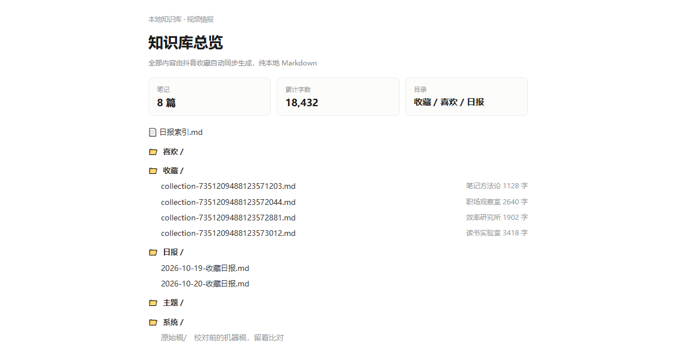
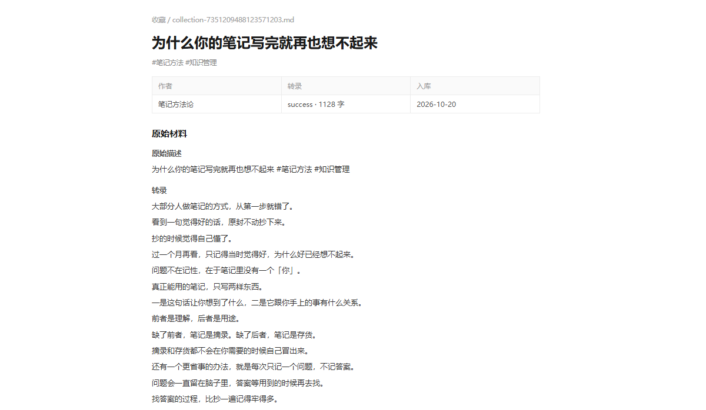

# AI 视频情报局

抖音收藏和喜欢里的视频，在电脑上跑一次，变成带标点的逐字稿笔记、每日日报和本地知识库。全部在本机完成，不上传。

WorkBuddy 技能包。核心是一条流水线：**抓 → 转 → 校 → 存 → 析**。



## 它产出什么

| | 内容 |
|---|---|
| 一篇笔记 | 每条视频一篇，属性表加逐字稿，标点齐全，一句一行 |
| 一份日报 | 每天汇总当天新入库的条目，没口播的自动过滤 |
| 一个能搜的库 | 搜逐字稿正文，不是搜标题 |
| 一张总览页 | 按主题分组的索引，一条一句评价 |

笔记是标准 Markdown，Obsidian 双链格式，用记事本也能打开。推荐的阅读器是 Obsidian，Notion、思源、飞书文档也能用。



## 装

需要 Python 3.10 以上。ffmpeg 装的时候自动处理，不用提前弄。

```bash
git clone https://github.com/wangge-dev/video-daily-intel.git ~/.workbuddy/skills/video-daily-intel
cd ~/.workbuddy/skills/video-daily-intel
python scripts/install.py
```

Windows 也可以直接双击 `一键安装(Windows).bat`，Mac 双击 `一键安装(Mac).command`。

安装做四件事：建独立环境 `~/.workbuddy/vdi-runtime` → 装依赖 → 装引擎 → 打兼容补丁。不动系统 Python。

装完验证：

```bash
cd scripts && ./run.cmd status      # Windows
cd scripts && ./run.sh status       # Mac
```

返回 `{"status": "logged_out"}` 或 `{"status": "authenticated"}` 就说明环境没问题。

## 配

```bash
./run.cmd setup --knowledge-dir "D:\我的知识库\视频情报"   # 1. 定知识库位置
./run.cmd login --timeout 300                              # 2. 扫码绑定抖音
./run.cmd sync --max-items 5                               # 3. 跑一次
```

第 2 步弹出本机 Chrome 的抖音登录页，用手机抖音扫码。**扫平时收藏视频那个号**，扫错了会一直抓到 0 条。

## 用

在 WorkBuddy 里直接说：

| 场景 | 说一句 |
|---|---|
| 日常同步 | 立即同步收藏，出今天的日报 |
| 单条拆解 | 帮我拆解这个视频：https://v.douyin.com/xxxx/ |
| 校对逐字稿 | 这几篇人名术语校对一遍 |
| 整理知识库 | 整理一下知识库，按主题归类 |
| 看库状态 | 看看哪些笔记还没校对 |

产出结构：

```
知识库/
├── 收藏/collection-<id>.md      # 每条视频一篇，含逐字稿
├── 喜欢/like-<id>.md
├── 日报/2026-10-21-收藏日报.md
├── 00_总览.md                   # 按主题分组的索引
├── 主题/  分析/                 # 同一话题够 3 篇再建
└── 模板/  系统/原始稿/          # 原始稿是校对前的机器稿，留着比对
```

## 转完之后

前两段脚本干，后三段看内容决定做到什么程度。

**校对按题材分档。** 段子、小品、影视解说标点齐了就能读，只查人名；访谈、教学口播抽查前 20 行，错得多再整篇校；历史、法律、医学这类术语密集的必须整篇校。

**校完才算终稿。** 覆盖前把机器稿存进 `系统/原始稿/`，笔记头部加一行 `proofread`。没有这行标记的都还是机器稿，别直接引用。

**整理分三层，只做够用的那层。** `00_总览.md` 每次同步后更新；同一话题够 3 篇再建 `主题/` 页；要出文章或方案才写 `分析/` 页。

两个小工具：

```bash
python kb_status.py          # 全库状态：字数、标点密度、校对标记、无口播
python kb_status.py --todo   # 只看还没处理的
python kb_index.py           # 按话题标签分组，生成主题草稿
```

## 要清楚的几件事

**收藏 ≠ 喜欢。** ⭐ 收藏走 `--source collection`（默认），❤️ 喜欢走 `--source like`。

**只对说话的视频有用。** 纯音乐、纯字幕、剧情片段转不出东西，日报会自动过滤掉这类空条目。

**转写速度看有没有显卡。** 有 NVIDIA 显卡约 6 倍速，纯 CPU 约 2 倍速。安装时自动检测，有卡就装 CUDA 运行库。

所以不建议设每天早上定时任务，那个点根本跑不完。要自动就定在半夜。

**转写时别开游戏。** 显卡被别的程序占着，同一条视频可能要跑好几倍时间。

**专业名词仍会错。** 默认模型没有历史、法律、医学术语这些知识，术语和人名基本靠音猜。错法有规律，模型按读音找字，同一个音基本错成同一个字，所以能建对照表批量改。

**关于账号风险。** 工具复用本机浏览器的登录态，请求抖音 Web 端收藏列表接口。这属于账号风控和平台条款层面的问题，不是私密数据问题，Cookie 只存本地。但高频、大批量抓取可能触发风控，别一天跑几百条。

## 出处

底层引擎：[tars1230/douyin-favorites-to-knowledge](https://github.com/tars1230/douyin-favorites-to-knowledge) v2.3.3（MIT）+ `douyin-knowledge-core` 0.2.1（专有）。

本版重写了安装器、兼容补丁和全部文档，主要解决三类问题：新版依赖装不上、长视频转写整篇没标点、每次同步都重复转写旧条目。补丁集中在 `scripts/patch_runtime.py`，幂等，重装后重跑一次即可。

## 出问题先看这里

| 现象 | 处理 |
|---|---|
| 同步成功但 0 条 | 确认扫的是对的号；确认点的是 ⭐收藏不是 ❤️喜欢 |
| `sec_user_id_missing` | `python scripts/patch_runtime.py` 重打补丁 |
| 转写报 TypeError | 同上 |
| `no_speech` | 视频没口播，不是故障 |
| 浏览器起不来 | 装 Chrome 或 Edge；或 `python -m playwright install chromium` |
| 下载音频失败 | 登录态过期，重新 `./run.cmd login` |
| 逐字稿没标点、一行只有几个字 | 提示词补丁没打上，重跑 `python scripts/patch_runtime.py` |
| 长视频整篇没标点，单独切一段又有 | 长音频标点漂移，按 5 分钟切块重转，每块重新给提示词 |
| 换 medium 后报显存不足 | 2 GB 显存放不下 medium，改回 small 或走 CPU |
| 装引擎时下载失败 | 手动下载 core wheel 放进 `wheels/`，见 `wheels/README.md` |

## 授权

本仓库作者编写的安装器、补丁、工具脚本与文档按 MIT 授权，见 [LICENSE](LICENSE)。

上游引擎的权属、core 组件为什么不随仓库分发，见 [NOTICE.md](NOTICE.md)。

## 相关

作者：[wangge-dev](https://github.com/wangge-dev)
